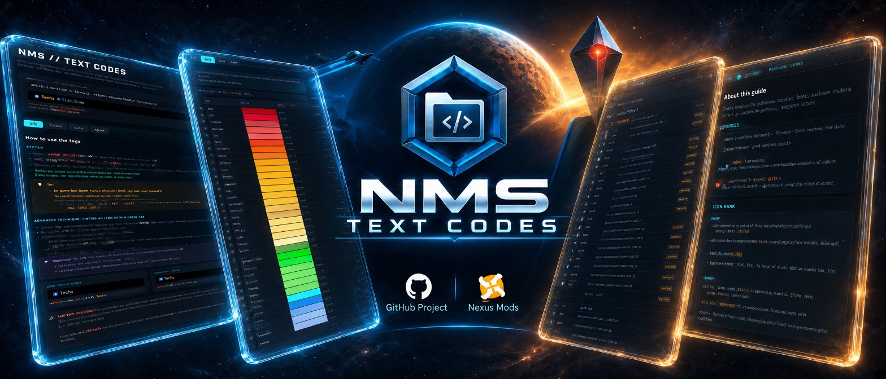

<!--    BANNER    -->

   

<!--    TITRE    -->

   <h1>NMS // TEXT CODES</h1> 
   <em>— The Reference Guide for No Man's Sky Text Codes —</em>

 

   <i>Unofficial project, created @Data-Spirit, based on in-game testing wherever possible, combined with test results and information shared by the No Man's Sky community. Not affiliated with Hello Games.</i>

 

<!-- BADGES CENTRES + LIENS HYPERTEXT INCLUS -->

  
  
  
  
  

  

---

## 🎮 What is this?

> **No Man's Sky lets you customize names** (bases, ships, freighters, multi-tools, storage containers, star systems, and more) using an in-game text-tag system for **colors and icons** that Hello Games has never officially documented.
> 
> _The information exists, but has historically been scattered across screenshots, player trial-and-error, forums, and community guides._
> 
> **NMS // TEXT CODES** brings this information together into a **single structured and interactive reference guide** — designed to work both as a reference and as a practical tool while you play.

## 🛠️ How to Use

**Download** → _open the HTML file in your browser_ → _pick your language (or let it be detected)_ → _search or browse the tables_ → _click to copy_ → _paste in-game_.

**No installation is required**, and the guide is designed to work **fully offline** once downloaded.

_You can also browse the hosted version directly from your browser through **🌐Online Version**._

🌐 Online Version : 

- 👉 [🌐 **NMS // TEXT CODES — Online Guide (multilingual)** ↗️](https://data-spirit.github.io/NMS_TC/LANG/NMS_txt_code.html)

---

## ✨ Why this guide stands out

* 🌍 **Multilingual, in a single file :** Several languages are built in, with a **language selector**. The guide picks your browser's language automatically, remembers your choice, and its address follows the displayed language (`?lang=xx`), so you can share a direct link.
* 📦 **A single, fully self-contained HTML file :** no installation, no critical external dependencies. Open it in your browser, **offline, anywhere**.
* 🎨 **59 color tags** documented with **exact HEX code, transparency and category**, plus **4 clickable sort modes** *(name, color, HEX, luminosity)* and instant search.
* 🖼️ **145 icon tags**, illustrated with **129 original icons extracted straight from the game files** *(sharp 64 × 64 versions, not generic placeholders)*, grouped into **12 categories**, with **duplicate / non-functional / unconfirmed status badges :** all icons are embedded directly in the file, with **no external images needed**.
* ⚡ **A live simulator :** type your tags and see the result rendered instantly, before pasting it in-game — including the well-known **icon-tinting trick**, and **instant error detection** for misspelled or wrongly cased tags.
* 📝 **Examples :** includes **10 real, in-game usage examples** to get you started, each one **copyable in a click**.
* ⧉ **One-click copy :** on every row of the color and icon tables, on every example, and in the simulator.
* 🎭 **A "meta" visual identity :** the interface's own accent colors are borrowed directly from the **real in-game tags** it documents.
* 💾 **Built to last :** no ephemeral spreadsheet links, no forum posts scattered across years of replies: just **one file** you can download and consult offline, whenever you need it.
* 🔍 **Full transparency** about what's confirmed, uncertain, or non-functional — nothing is presented with more certainty than it deserves.

---

## 🌍 Available Languages

The project is currently available in:

* 🇫🇷 **French** — [README_FR](https://github.com/Data-Spirit/NMS_TC/blob/main/LANG/FR/README_FR.md)
* 🇬🇧 **English** — [README_EN](https://github.com/Data-Spirit/NMS_TC/blob/main/LANG/EN/README_EN.md)
* 🇪🇸 **Spanish** — [README_ES](https://github.com/Data-Spirit/NMS_TC/blob/main/LANG/ES/README_ES.md)

🇩🇪 **German** and 🇮🇹 **Italian** are planned for future releases.

More languages may be added over time.

**Long-term goal** : _make NMS // TEXT CODES available in every language officially supported by Hello Games in No Man's Sky, so that players around the world can use the guide in their own language._

---

## 🔗 Follow the project on GitHub

The guide keeps evolving: new languages, fixes and improvements.

The GitHub repository also includes the full source code, a reusable icon bank of transparent PNGs extracted from the game (with a provenance table, `SOURCES.csv`), additional documentation, the translation prompts and check scripts, and language-specific README files explaining the guide in detail.

The guide is also self-hosted on **GitHub Pages**, so you can browse it online directly from your browser, without downloading anything.

---

📜 License & Disclaimer

   > Original content created by Spirit is licensed under [**CC BY-NC-SA 4.0**](https://github.com/Data-Spirit/NMS_TC/blob/main/LICENSE.md).
   > 
   > No Man's Sky and all related game assets, trademarks, and intellectual property remain the property of **Hello Games** and/or their respective rights holders.
   > 
   > _This is an unofficial community-created resource and is **not affiliated with, endorsed by, or sponsored by Hello Games**._

 

---

 

<!--   RELEASE + PATCH NOTE   -->

   <h1>Release + PATCH NOTES</h1> 
   <em>— v2.1 — Icons straight from the game —</em>

 

**v2.1 replaces every icon of the guide with the game's own textures.** Until now, the icons had been cut out of screenshots. They are now **extracted directly from No Man's Sky's files**, in the highest resolution the game provides, and embedded at **64 × 64**: sharper everywhere, especially on high-density screens. The tag syntax, the data and the interface are unchanged.

## 🔎 Highlights

- 🖼️ **Original game icons.** The 129 icons shown in the guide now come from the game's `.pak` archives, extracted with **NMSModTool v1.1.0.0**, then converted to transparent PNGs without loss of quality.
- 🔍 **Best available resolution.** For each tag, the highest-resolution version of the same artwork was kept (54 icons at 256 × 256, 26 at 128 × 128, 17 at 64 × 64, 32 at 32 × 32), then resized to 64 × 64 for the guide.
- ✅ **Verified against the source.** **97 of the 129 icons are pixel-identical** to their original `.DDS` texture; the others were retouched, upscaled or recomposed when the game only offered a version that was too small or unsuitable — and they are listed as such.
- 📋 **A provenance table for every icon.** The new `SOURCES.csv` (in `docs/assets/BANK_ICONS/`) gives, for each icon, the texture the tag points to, the source of the image, its original resolution and its match level.
- 🎨 **Better tint preview.** Three icons that are white in the game (`CREATURE`, `INTERACTABLE`, `SENTINEL`) can now be tinted in the simulator.

## ⚠️ Breaking changes & migration

- **None.** Same file name (`NMS_txt_code.html`), same tag syntax, same data: 59 color tags, 145 icon tags, 12 categories. Nothing you already use in-game changes.
- **File size:** ≈ 359 KB → **≈ 447 KB**, the cost of icons twice as sharp.
- **Download link:** the README's download button now always points to the **latest release**, so it no longer needs updating at each version.

## ✨ Added

- **`SOURCES.csv`** in `docs/assets/BANK_ICONS/`: one row per icon (145), with `tag_texture`, `image_source_dds`, `original_resolution`, `same_as_tag_texture`, `match` (`rgba-exact`, `pixel-exact`, `compatible`, `modified`, `created`, `legacy-screenshot`) and notes.
- **Probable texture paths** for 4 icons previously marked "to verify" (`FRIGPIRATE`, `ICON_NIN`, `FLIPVERT`, `MIRROR`), found during extraction in the same game folders as their confirmed neighbours. Their **to verify** badge is kept until confirmed in-game.
- **Icon bank archive** with three sets: 32 × 32, 64 × 64 and the originals at full resolution.

## 🔄 Changed

- **All 129 displayed icons replaced** by the game's original textures, embedded at 64 × 64 (base64 in `ICON_DATA`, as before).
- **Icon table column renamed** "Tag texture" (FR « Texture de la balise », ES « Textura de la etiqueta »): it shows the `.DDS` file the **tag** points to, which is not always the file the bank image comes from.
- **Untinted-icon list updated** for the new textures: `CREATURE`, `INTERACTABLE` and `SENTINEL` removed (white in the game), `PLAYER0` added (dark outline that a tint would flatten). 23 icons keep their own colors in the simulator.
- **About tab** rewritten in **French, English and Spanish** to describe where the icons come from, how they are embedded and where to find the icon bank. Every language block is now at version **2.1**.
- **READMEs** updated (FR, EN, ES v2.3; main README v3.9) with the full extraction process.

## 🧪 Validation performed

The checks below were run on the final `NMS_txt_code.html`, in every language:

- **Keys and safety** (`trans_script_1_check_keys.py`, strict mode, with `--since` against v2.0): **31 checks passed, 0 failed**.
- **Behavior** (`trans_script_2_test_behavior.js`, jsdom): **35 checks passed for each language** (FR, EN, ES), including a render comparison with the previous build.
- **Robustness** (`trans_script_3_test_robustness.js`): **all passed**.
- **Render comparison** (`trans_script_4_test_render.js`): against v2.0, the only differences are the new icon images; adding the EN/ES translations left the French render strictly identical.
- **Icon data:** all 145 embedded images decode as valid PNGs and are byte-identical to the files of `BANK_ICONS/`; everything outside `ICON_DATA` was left untouched when the icons were replaced.

> These checks validate the logic and the generated structure in jsdom, **not the behavior in real browsers** nor the visual appearance.

## 📌 Known limitations

- **32 of the 129 icons are not pixel-identical** to a game texture (retouched, upscaled or recomposed): `SOURCES.csv` lists them.
- The **16 non-functional controller tags** (`*_W`) still use the images from the previous, screenshot-based bank, kept in reserve.
- On **narrow phone screens**, the "Tag texture" column of the icon table is not visible.
- Same documented limits as before: right-to-left languages are not supported, the selector's flags are emoji, 12 icon textures remain **unconfirmed**, the exact color of `TRANS_ANM` is unconfirmed, and the **icon-tinting trick** is an observed in-game behavior, not a documented guarantee.

## 📦 Asset & checksum

| File | Size | SHA-256 |
|---|---|---|
| `NMS_txt_code.html` | 457,704 bytes (≈ 447 KB) | `5614b845da888126d5955f371b18450e20af7020a25745980dac151ba39f7736` |

**Full Changelog**: https://github.com/Data-Spirit/NMS_TC/compare/v2.0...v2.1
