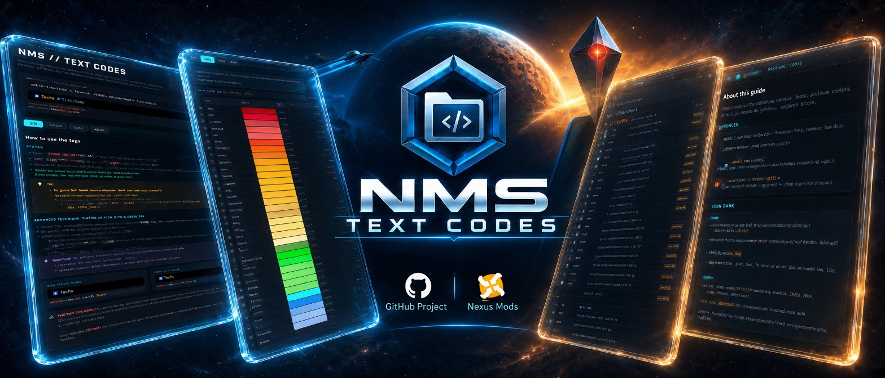

<!--    BANNER    -->

   

<!--    TITRE    -->

   <h1>NMS // TEXT CODES</h1> 
   <em>— The Reference Guide for No Man's Sky Text Codes —</em>

 

   <i>Unofficial project, created @Data-Spirit, based on in-game testing wherever possible, combined with test results and information shared by the No Man's Sky community. Not affiliated with Hello Games.</i>

 

<!-- BADGES CENTRES + LIENS HYPERTEXT INCLUS -->

  
  
  
  
  

  

---

## 🎮 What is this?

> **No Man's Sky lets you customize names** (bases, ships, freighters, multi-tools, storage containers, star systems, and more) using an in-game text-tag system for **colors and icons** that Hello Games has never officially documented.
> 
> _The information exists, but has historically been scattered across screenshots, player trial-and-error, forums, and community guides._
> 
> **NMS // TEXT CODES** brings this information together into a **single structured and interactive reference guide** — designed to work both as a reference and as a practical tool while you play.

## 🛠️ How to Use

**Download** → _open the HTML file in your browser_ → _pick your language (or let it be detected)_ → _search or browse the tables_ → _click to copy_ → _paste in-game_.

**No installation is required**, and the guide is designed to work **fully offline** once downloaded.

_You can also browse the hosted version directly from your browser through **🌐Online Version**._

🌐 Online Version : 

- 👉 [🌐 **NMS // TEXT CODES — Online Guide (multilingual)** ↗️](https://data-spirit.github.io/NMS_TC/LANG/NMS_txt_code.html)

---

## ✨ Why this guide stands out

* 🌍 **Multilingual, in a single file :** Several languages are built in, with a **language selector**. The guide picks your browser's language automatically, remembers your choice, and its address follows the displayed language (`?lang=xx`), so you can share a direct link.
* 📦 **A single, fully self-contained HTML file :** no installation, no critical external dependencies. Open it in your browser, **offline, anywhere**.
* 🎨 **59 color tags** documented with **exact HEX code, transparency and category**, plus **4 clickable sort modes** *(name, color, HEX, luminosity)* and instant search.
* 🖼️ **145 icon tags**, illustrated with **129 original icons extracted straight from the game files** *(sharp 64 × 64 versions, not generic placeholders)*, grouped into **12 categories**, with **duplicate / non-functional / unconfirmed status badges :** all icons are embedded directly in the file, with **no external images needed**.
* ⚡ **A live simulator :** type your tags and see the result rendered instantly, before pasting it in-game — including the well-known **icon-tinting trick**, and **instant error detection** for misspelled or wrongly cased tags.
* 📝 **Examples :** includes **10 real, in-game usage examples** to get you started, each one **copyable in a click**.
* ⧉ **One-click copy :** on every row of the color and icon tables, on every example, and in the simulator.
* 🎭 **A "meta" visual identity :** the interface's own accent colors are borrowed directly from the **real in-game tags** it documents.
* 💾 **Built to last :** no ephemeral spreadsheet links, no forum posts scattered across years of replies: just **one file** you can download and consult offline, whenever you need it.
* 🔍 **Full transparency** about what's confirmed, uncertain, or non-functional — nothing is presented with more certainty than it deserves.

---

## 🌍 Available Languages

The project is currently available in:

* 🇫🇷 **French** — [README_FR](https://github.com/Data-Spirit/NMS_TC/blob/main/LANG/FR/README_FR.md)
* 🇬🇧 **English** — [README_EN](https://github.com/Data-Spirit/NMS_TC/blob/main/LANG/EN/README_EN.md)
* 🇪🇸 **Spanish** — [README_ES](https://github.com/Data-Spirit/NMS_TC/blob/main/LANG/ES/README_ES.md)

🇩🇪 **German** and 🇮🇹 **Italian** are planned for future releases.

More languages may be added over time.

**Long-term goal** : _make NMS // TEXT CODES available in every language officially supported by Hello Games in No Man's Sky, so that players around the world can use the guide in their own language._

---

## 🔗 Follow the project on GitHub

The guide keeps evolving: new languages, fixes and improvements.

The GitHub repository also includes the full source code, a reusable icon bank of transparent PNGs extracted from the game (with a provenance table, `SOURCES.csv`), additional documentation, the translation prompts and check scripts, and language-specific README files explaining the guide in detail.

The guide is also self-hosted on **GitHub Pages**, so you can browse it online directly from your browser, without downloading anything.

---

📜 License & Disclaimer

   > Original content created by Spirit is licensed under [**CC BY-NC-SA 4.0**](https://github.com/Data-Spirit/NMS_TC/blob/main/LICENSE.md).
   > 
   > No Man's Sky and all related game assets, trademarks, and intellectual property remain the property of **Hello Games** and/or their respective rights holders.
   > 
   > _This is an unofficial community-created resource and is **not affiliated with, endorsed by, or sponsored by Hello Games**._

 

---

 

<!--   RELEASE + PATCH NOTE   -->

   <h1>Release + PATCH NOTES</h1> 
   <em>— v2.2 — Polished under the hood —</em>

 

**v2.2 is a quality release.** The whole code of the guide went through a complete review: bugs fixed (mostly on phones), sturdier language handling, real bold text, better accessibility and an extra layer of security. The content, the tags, the icons and the translations are exactly the same as in v2.1.

## 🔎 Highlights

- 📱 **Better on phones.** The "Tag texture" column of the icon tables is visible again (the table now scrolls sideways), color rows no longer have an empty gap, and the language selector no longer overlaps the title.
- ⌨️ **Keyboard-friendly tabs.** The four tabs follow the standard accessibility pattern: the active tab is announced by screen readers, and you can switch tabs with the arrow keys, Home and End.
- ⧉ **Honest copy feedback.** The copy button shows ✓ only when the copy really worked, and a red ✗ if the browser refused it.
- 🔒 **Locked-down page.** A built-in Content Security Policy only allows the fonts to be loaded: the page cannot contact any other server.
- 🔤 **Real bold.** The bold weight of the main font is now actually loaded (no more synthetic bold), and two unused font weights are no longer downloaded.

## ⚠️ Breaking changes & migration

- **None.** Same file name (`NMS_txt_code.html`), same content, same data, same translations.
- **File size:** ≈ 447 KB → **≈ 451 KB**.

## 🛠️ Fixed

- **Phones (≈ 375 px):** the icon-table "Tag texture" column was squeezed to zero width; it now keeps a minimum width and the table scrolls horizontally, as intended.
- **Phones:** every color row had an extra empty line (the hidden transparency cell still took up space).
- **Phones:** the language selector overlapped the small title above the guide name.
- **Saved language:** an invalid saved value (such as `constructor` or `toString`) could be accepted and leave the page in an inconsistent state; it is now checked against the available languages, exactly like `?lang=`.
- **Simulator:** a non-functional icon tag typed in lowercase (e.g. `circle_w`) was reported as unknown instead of suggesting the uppercase fix.
- **Copy:** the ✓ confirmation was shown even when the copy had failed.
- **Fonts:** the bold weight used by the main text was not loaded, so browsers synthesized a fake bold.

## ✨ Added

- **Accessible tabs** (ARIA *tabs* pattern) with keyboard navigation and a visible focus outline.
- **`aria-label` on every copy button** of the tables, so screen readers announce what is copied.
- **Spell-check and autocomplete disabled** in the simulator and the search fields, where you type tags, not words.
- **Content Security Policy** in the file itself.
- **A short message when JavaScript is disabled** (in French, English and Spanish) instead of a blank page.
- **A code review guide for the project**, [`docs/prompts/prompt_code_review_NMS_TC.md`](https://github.com/Data-Spirit/NMS_TC/blob/main/docs/prompts/prompt_code_review_NMS_TC.md): project invariants, security, performance, accessibility and responsive rules, tools and checks.

## 🔄 Changed

- **Lighter work for the browser:** an invisible blur effect behind the tab bar was removed, transitions only animate the properties that change, and the color sort no longer searches a list at every comparison.
- **Cleaner code:** dead CSS removed, outdated comments fixed, shared helpers for color conversions, every intentionally ignored error now explained, and all code comments harmonized in French.

## 🧪 Validation performed

- **Code quality:** ESLint (recommended rules) **0 issue**; `html-validate` and Stylelint limited to the documented, accepted exceptions.
- **Keys and safety** (`trans_script_1_check_keys.py`, strict mode): **29 checks passed, 0 failed**.
- **Behavior** (`trans_script_2_test_behavior.js`): **all passed** in French, English and Spanish.
- **Robustness** (`trans_script_3_test_robustness.js`): **all passed**.
- **Render comparison** with v2.1 (`trans_script_4_test_render.js`): identical in every language, apart from the intended markup changes (accessibility attributes, `<noscript>` message).
- **Invariants:** the icon data and the three language blocks are byte-identical to v2.1.
- **In a browser:** tested on desktop and at phone width (375 px) in all three languages; no console error and no security-policy violation.

> These checks were run in jsdom and in a Chromium-based browser; Firefox and Safari were not tested for this release.

## 📌 Known limitations

- Same as v2.1: right-to-left languages are not supported, the selector's flags are emoji, 32 of the 129 icons are not pixel-identical to a game texture (see `SOURCES.csv`), the 16 non-functional controller tags still use screenshot-based images, 12 icon textures remain unconfirmed, the exact color of `TRANS_ANM` is unconfirmed, and the icon-tinting trick is an observed in-game behavior.

## 📦 Asset & checksum

| File | Size | SHA-256 |
|---|---|---|
| `NMS_txt_code.html` | 462,234 bytes (≈ 451 KB) | `23852d1373598b699b048949d418c996ae9475d2a0075c677490f87a51f75407` |

**Full Changelog**: https://github.com/Data-Spirit/NMS_TC/compare/v2.1...v2.2
