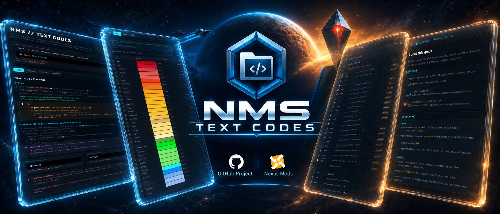

<!--    BANNER    -->

   

<!--    TITRE    -->

   <h1>NMS // TEXT CODES</h1> 
   <em>— The Reference Guide for No Man's Sky Text Codes —</em>

 

   <i>Unofficial project, created @Data-Spirit, based on in-game testing wherever possible, combined with test results and information shared by the No Man's Sky community. Not affiliated with Hello Games.</i>

 

<!-- BADGES CENTRES + LIENS HYPERTEXT INCLUS -->

  
  
  
  
  

  

---

## 🎮 What is this?

> **No Man's Sky lets you customize names** (bases, ships, freighters, multi-tools, storage containers, star systems, and more) using an in-game text-tag system for **colors and icons** that Hello Games has never officially documented.
> 
> _The information exists, but has historically been scattered across screenshots, player trial-and-error, forums, and community guides._
> 
> **NMS // TEXT CODES** brings this information together into a **single structured and interactive reference guide** — designed to work both as a reference and as a practical tool while you play.

## 🛠️ How to Use

**Download** → _open the HTML file in your browser_ → _pick your language (or let it be detected)_ → _search or browse the tables_ → _click to copy_ → _paste in-game_.

**No installation is required**, and the guide is designed to work **fully offline** once downloaded.

_You can also browse the hosted version directly from your browser through **🌐Online Version**._

🌐 Online Version : 

- 👉 [🌐 **NMS // TEXT CODES — Online Guide (multilingual)** ↗️](https://data-spirit.github.io/NMS_TC/LANG/NMS_txt_code.html)

---

## ✨ Why this guide stands out

* 🌍 **Multilingual, in a single file :** Several languages are built in, with a **language selector**. The guide picks your browser's language automatically, remembers your choice, and its address follows the displayed language (`?lang=xx`), so you can share a direct link.
* 📦 **A single, fully self-contained HTML file :** no installation, no critical external dependencies. Open it in your browser, **offline, anywhere**.
* 🎨 **59 color tags** documented with **exact HEX code, transparency and category**, plus **4 clickable sort modes** *(name, color, HEX, luminosity)* and instant search.
* 🖼️ **145 icon tags**, illustrated with **129 original icons extracted straight from the game files** *(sharp 64 × 64 versions, not generic placeholders)*, grouped into **12 categories**, with **duplicate / non-functional / unconfirmed status badges :** all icons are embedded directly in the file, with **no external images needed**.
* ⚡ **A live simulator :** type your tags and see the result rendered instantly, before pasting it in-game — including the well-known **icon-tinting trick**, and **instant error detection** for misspelled or wrongly cased tags.
* 📝 **Examples :** includes **10 real, in-game usage examples** to get you started, each one **copyable in a click**.
* ⧉ **One-click copy :** on every row of the color and icon tables, on every example, and in the simulator.
* 🎭 **A "meta" visual identity :** the interface's own accent colors are borrowed directly from the **real in-game tags** it documents.
* 💾 **Built to last :** no ephemeral spreadsheet links, no forum posts scattered across years of replies: just **one file** you can download and consult offline, whenever you need it.
* 🔍 **Full transparency** about what's confirmed, uncertain, or non-functional — nothing is presented with more certainty than it deserves.

---

## 🌍 Available Languages

The project is currently available in:

* 🇫🇷 **French** — [README_FR](https://github.com/Data-Spirit/NMS_TC/blob/main/LANG/FR/README_FR.md)
* 🇬🇧 **English** — [README_EN](https://github.com/Data-Spirit/NMS_TC/blob/main/LANG/EN/README_EN.md)
* 🇪🇸 **Spanish** — [README_ES](https://github.com/Data-Spirit/NMS_TC/blob/main/LANG/ES/README_ES.md)

🇩🇪 **German** and 🇮🇹 **Italian** are planned for future releases.

More languages may be added over time.

**Long-term goal** : _make NMS // TEXT CODES available in every language officially supported by Hello Games in No Man's Sky, so that players around the world can use the guide in their own language._

---

## 🔗 Follow the project on GitHub

The guide keeps evolving: new languages, fixes and improvements.

The GitHub repository also includes the full source code, a reusable icon bank of transparent PNGs extracted from the game (with a provenance table, `SOURCES.csv`), additional documentation, the translation prompts, the review procedure and the check scripts, and language-specific README files explaining the guide in detail.

The guide is also self-hosted on **GitHub Pages**, so you can browse it online directly from your browser, without downloading anything.

---

📜 License & Disclaimer

   > Original content created by Spirit is licensed under [**CC BY-NC-SA 4.0**](https://github.com/Data-Spirit/NMS_TC/blob/main/LICENSE.md).
   > 
   > No Man's Sky and all related game assets, trademarks, and intellectual property remain the property of **Hello Games** and/or their respective rights holders.
   > 
   > _This is an unofficial community-created resource and is **not affiliated with, endorsed by, or sponsored by Hello Games**._

 

---

 

<!--   RELEASE + PATCH NOTE   -->

   <h1>Release + PATCH NOTES</h1>
   <em>— v2.3 — Reviewed from top to bottom —</em>

 

**v2.3 is the result of the project's first full review**, done with its new review procedure: the check scripts first, then the code of the guide, then the documentation. In the guide itself, two accessibility improvements; the content, the tags, the icons and the translations are exactly the same as in v2.2. Most of the work happened behind the scenes, so that every future change can be checked with tools you can trust.

## 🔎 Highlights

- ♿ **Smoother with a screen reader.** The decorative icons of the information boxes (💡 ★ ⚠ ℹ) are no longer read aloud, and each tab panel can be reached with the keyboard right after its tab.
- 🧪 **Check scripts you can trust.** Known faults were injected into copies of the guide to test the check scripts themselves: four blind spots were found and fixed. A new script now replays these faults at every review.
- 📚 **A complete review procedure.** Three review types (tools, code, documentation) and a full review that chains them, with a list of known pitfalls and their solutions.
- 🌍 **Ready for new languages.** A step-by-step prompt to add a language to the guide and to the repository without forgetting anything.

## ⚠️ Breaking changes & migration

- **None for the guide.** Same file name (`NMS_txt_code.html`), same content, same data, same translations, same online address.
- **File size:** ≈ 451 KB (462,234 → 462,400 bytes).
- **GitHub Pages:** the root of the site (`https://data-spirit.github.io/NMS_TC/`) no longer shows an empty page; it returns a "not found" page on purpose. The guide's online address does not change.

## 🛠️ Fixed

- **READMEs (FR, EN, ES):** the "Icons" and "About" links of the table of contents led nowhere (the emojis of those headings put an invisible character in GitHub's anchors); the tab headings now have fixed anchors.
- **Check scripts:** a duplicated language block, or a malformed one, could go unnoticed by the key check; the render comparison silently compared the default language when asked for a missing one; the language requested in the address (`?lang=`) was never tested.

## ✨ Added

- **Accessibility:** decorative icons hidden from screen readers (`aria-hidden`), tab panels reachable with the keyboard (`tabindex`).
- **A fault-injection script** (`trans_script_5_test_mutations.py`) that checks the four other check scripts against 13 known faults.
- **Wider test coverage:** tabs with the mouse and the keyboard, refused copy (✗), `?lang=`, hostile values from the address and the storage.
- **Project documentation:** [review procedure](https://github.com/Data-Spirit/NMS_TC/blob/main/docs/revision.md), [master review prompt](https://github.com/Data-Spirit/NMS_TC/blob/main/docs/prompts/prompt_revision_NMS_TC.md), [known pitfalls](https://github.com/Data-Spirit/NMS_TC/blob/main/docs/pitfalls.md), [prompt to add a language](https://github.com/Data-Spirit/NMS_TC/blob/main/docs/prompts/prompt_add_language_NMS_TC.md), a [changelog](https://github.com/Data-Spirit/NMS_TC/blob/main/CHANGELOG.md) and a [roadmap](https://github.com/Data-Spirit/NMS_TC/blob/main/ROADMAP.md).

## 🔄 Changed

- **Check scripts v1.1:** clearer messages and a usage error code when a file is missing.
- **READMEs v2.7:** repository tree completed, size of a language block corrected (about 14 KB).
- **The previous code review prompt** is replaced by the review procedure (archived in `docs/_legacy/`).

## 🧪 Validation performed

- **Keys and safety** (`trans_script_1_check_keys.py`, strict mode): **31 checks passed, 0 failed**.
- **Behavior** (`trans_script_2_test_behavior.js`): **38 checks passed** in French, English and Spanish.
- **Robustness** (`trans_script_3_test_robustness.js`): **all passed**, including the new `?lang=` and hostile-value checks.
- **Render comparison** with v2.2 (`trans_script_4_test_render.js`): identical in every language once the intended accessibility attributes are set aside.
- **Check scripts** (`trans_script_5_test_mutations.py`): the guide passes every check, and **13 known faults out of 13** are detected by the expected script.
- **Invariants:** the icon data and the three language blocks are byte-identical to v2.2.
- **Code quality:** ESLint **0 issue**; `html-validate` and Stylelint limited to the documented, accepted exceptions.
- **In a browser:** no console error and no security-policy violation; measured times well within the project's budgets (full icon table about 2 ms, language switch about 3 ms).

> These checks were run in jsdom and in a Chromium-based browser; Firefox, Safari and real screen readers were not tested for this release.

## 📌 Known limitations

- Same as v2.2: right-to-left languages are not supported, the selector's flags are emoji, 32 of the 129 icons are not pixel-identical to a game texture (see `SOURCES.csv`), the 16 non-functional controller tags still use screenshot-based images (their game textures have been found and await an in-game test), 12 icon textures remain unconfirmed, the exact color of `TRANS_ANM` is unconfirmed, and the icon-tinting trick is an observed in-game behavior.

## 📦 Asset & checksum

| File | Size | SHA-256 |
|---|---|---|
| `NMS_txt_code.html` | 462,400 bytes (≈ 451 KB) | `07bf2465e1dbd2370327d0f5e9ecf8f51918671d871ad58265fe85dea1a36353` |

**Full Changelog**: https://github.com/Data-Spirit/NMS_TC/compare/v2.2...v2.3
